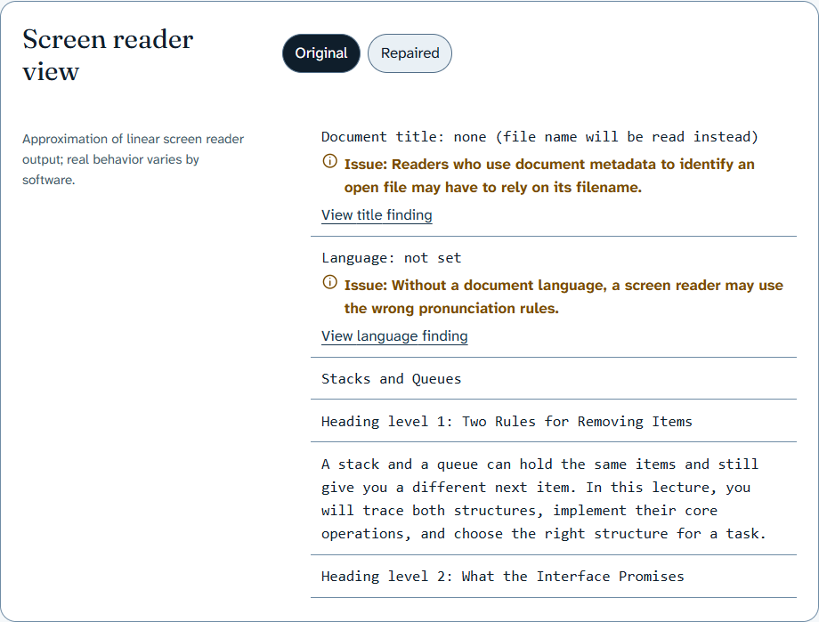
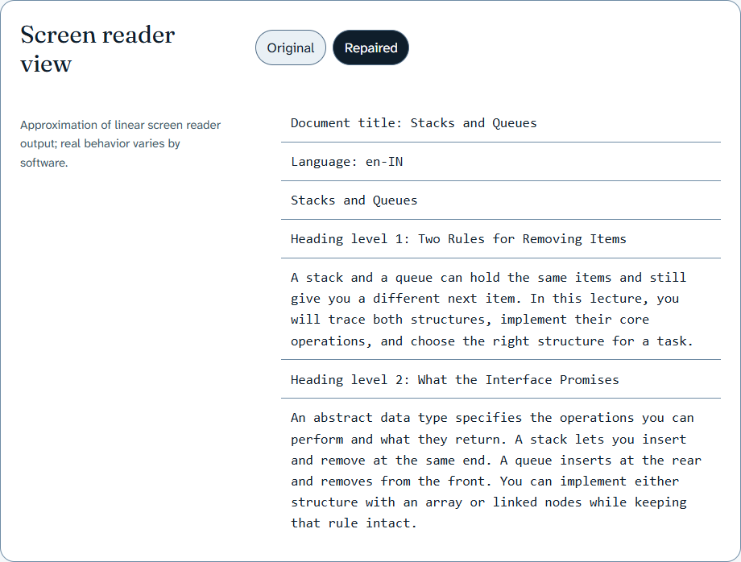
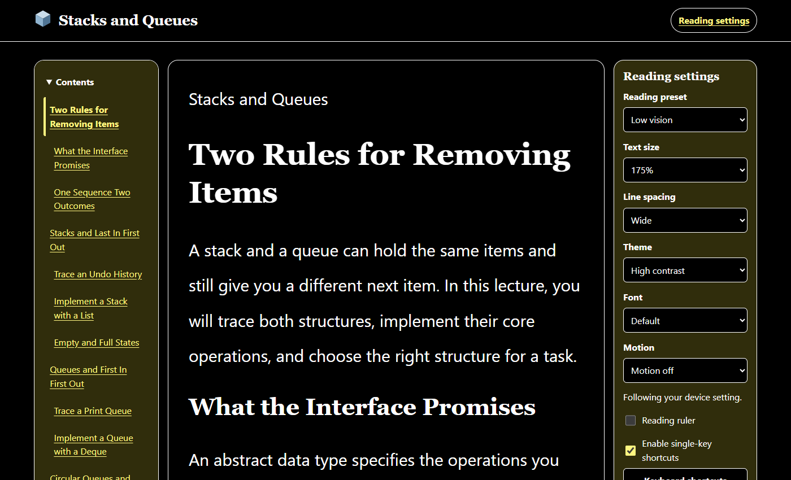

# A11yra

A11yra helps educators find and repair accessibility barriers in Word documents, then share the repaired material in a reader learners can adjust.

**[Live demo][demo] · [Project report (PDF)][report] · [Submission evidence][evidence]**

- **Audit six checks** for title, language, headings, image descriptions, table headers, and link text.
- **Review, repair, and re-audit** with a Word layout preview and a linear screen reader preview.
- **Share the verified result** as a repaired Word file, offline HTML, or a learner link you can revoke.

## Judge quick start

### Hosted demo

1. Open the [live demo][demo] and select **Try a messy handout** to start a guest audit of the Stacks and Queues lecture.
2. Choose **Review fix** on the title, language, image, and link findings. Apply the values in [the example result](#example-result).
3. Select **Re-audit document**, then **Run re-audit**. Check the verified fixes and select **Continue to export** to download and open the offline HTML reader.

### Docker

Use Docker Compose 2.24 or newer. From the repository root, run this command.

```sh
docker compose up --build --wait
```

Open [the local A11yra app](http://127.0.0.1:5173/) and choose **Try a sample audit**. Create an account or sign in to open the lecture. Run `docker compose down` to stop the services. Docker volumes retain the local database and files.

## Example result

The Stacks and Queues sample went from **2 of 6 checks passed** to **6 of 6** after four verified repairs.

| Check | Before | After |
| --- | --- | --- |
| Document title | Missing | Stacks and Queues |
| Default language | Missing | English (India), `en-IN` |
| Image description | Missing | Stacks remove the most recently added item first. Queues remove the earliest added item first. |
| Link text | “click here” | Further reading on stacks and queues |

| Original screen reader preview | Repaired screen reader preview |
| --- | --- |
|  |  |

[Original Word file](docs/evidence/original-lecture.docx) · [Repaired Word file](docs/evidence/repaired-lecture.docx) · [Recorded results](docs/evidence/live-results.json)



Save a copy of the [offline sample reader](docs/evidence/repaired-reader.html) and open it in a browser to try the reading settings.

## Run locally without Docker

Use Python 3.12 and Node.js 24, the versions used in CI. This setup uses SQLite and applies migrations at startup. Run the API and frontend in separate terminals.

<details>
<summary>Windows PowerShell</summary>

API terminal, from the repository root:

```powershell
python -m venv .venv
.\.venv\Scripts\python.exe -m pip install -r backend/requirements.txt
Set-Location backend
..\.venv\Scripts\python.exe -m uvicorn app.main:app --port 8000
```

Frontend terminal, from the repository root:

```powershell
npm.cmd --prefix frontend ci
npm.cmd --prefix frontend run dev
```

</details>

<details>
<summary>macOS or Linux</summary>

API terminal, from the repository root:

```sh
python3.12 -m venv .venv
.venv/bin/python -m pip install -r backend/requirements.txt
cd backend
../.venv/bin/python -m uvicorn app.main:app --port 8000
```

Frontend terminal, from the repository root:

```sh
npm --prefix frontend ci
npm --prefix frontend run dev
```

</details>

Both setups serve [the local A11yra app](http://127.0.0.1:5173/). The defaults work without an API key or mail provider. For configuration, see [the environment template](.env.example).

<details>
<summary>Use alternate ports</summary>

If the default ports are occupied, use the following commands after installing the dependencies. This example uses API port `8005` and Vite port `5175`.

API terminal, from `backend` (PowerShell):

```powershell
$env:A11YRA_PUBLIC_URL = 'http://127.0.0.1:5175'
$env:A11YRA_CORS_ORIGINS = 'http://127.0.0.1:5175'
..\.venv\Scripts\python.exe -m uvicorn app.main:app --port 8005
```

Frontend terminal, from the repository root (PowerShell):

```powershell
$env:A11YRA_DEV_API_PORT = '8005'
npm.cmd --prefix frontend run dev -- --port 5175
```

Open [the local app on port 5175](http://127.0.0.1:5175/). Use that exact origin in `A11YRA_CORS_ORIGINS` so sign-in accepts requests from Vite. On macOS or Linux, use `export NAME=value` for the same variables, `../.venv/bin/python` in the API terminal, and `npm` in the frontend terminal.

</details>

## Verification

Verified November 17, 2026. The backend suite passed **126 tests**, the browser suite passed **12 tests**, and the contrast script passed **132 checks**. The TypeScript check and Vite production build passed.

See [local verification commands](CONTRIBUTING.md), [GitHub Actions][ci], and the [manual accessibility checklist](docs/ACCESSIBILITY-TEST.md).

## Privacy and limitations

Uploads and working copies are private. Working files expire after 24 hours by default. Audit history defaults to 7 days on free workspaces and 30 days on paid plans, subject to the deployment cap. Teachers can delete uploads and revoke published reader links. See the [security policy](SECURITY.md), [security notes](docs/SECURITY-NOTES.md), and [deployment guide](docs/DEPLOYMENT.md).

A11yra checks common barriers it can detect in a DOCX. Teachers still need to review reading order, the meaning of headings and descriptions, and complex content such as equations or scanned pages. The score measures the checks A11yra evaluated. A11yra does not certify WCAG conformance.

## Project layout

| Path | Contents |
| --- | --- |
| [frontend/](frontend/) | React and TypeScript teacher workspace |
| [backend/](backend/) | FastAPI, Word audit and repair, exports, database migrations, and sample documents |
| [reader/](reader/) | Learner reader assets and browser tests |
| [docs/](docs/) | Setup, operations, accessibility references, and [submission evidence][evidence] |
| [CI workflow](.github/workflows/ci.yml) | Automated checks, dependency audits, PostgreSQL migrations, and Compose verification |

The app serves [interactive API docs](http://127.0.0.1:5173/api/docs) when running locally.

## History and credits

- The [first repository commit](https://github.com/hxrshx247-creator/A11yra/commit/79e6144) records the initial Word audit, repair, and export workflow on November 11, 2026.
- The [hackathon demo commit](https://github.com/hxrshx247-creator/A11yra/commit/c9a1732) records the sample lecture, screen reader previews, re-audit flow, and reader presets on November 12, 2026. Later commits added the formatted Word preview and finding highlights.
- A11yra uses React, Vite, FastAPI, python-docx, and Mammoth. The site bundles [Fraunces and Atkinson Hyperlegible Next](frontend/public/fonts) with their font licenses. Render hosts the demo.

[MIT license](LICENSE)

[demo]: https://a11yra-api.onrender.com/
[report]: docs/evidence/A11yra_Project_Report.pdf
[evidence]: docs/evidence/README.md
[ci]: https://github.com/hxrshx247-creator/A11yra/actions/workflows/ci.yml
