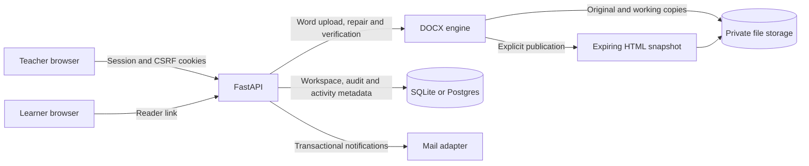

# A11yra

[](https://github.com/hxrshx247-creator/A11yra/actions/workflows/ci.yml)

A11yra helps teachers find, repair and verify common accessibility barriers in born-digital Word files. Teachers use an account and workspace to audit documents. Students can open an offline export or an expiring reader link.

## Run locally

From the repository root in PowerShell, install the development dependencies.

```powershell
python -m venv .venv
.\.venv\Scripts\python.exe -m pip install -r backend/requirements-dev.txt
npm.cmd --prefix frontend ci
```

Start the API and frontend in separate PowerShell terminals.

```powershell
.\.venv\Scripts\python.exe -m uvicorn app.main:app --app-dir backend --port 8000 --no-access-log
```

```powershell
npm.cmd --prefix frontend run dev
```

Open [A11yra](http://127.0.0.1:5173/). Sign up and sign in. The verification link appears in the API terminal and is required before inviting colleagues. Development uses SQLite and applies Alembic migrations on startup. Copy `.env.example` to `.env` to customize the configuration. Use `make dev` or `docker compose up --build` to run against Postgres. See the [API reference](http://127.0.0.1:5173/api/docs) and [operations guide](docs/OPERATIONS.md).

## Try the teacher workflow

1. Choose **Audit the sample syllabus** in your workspace. The sample starts at 2 of 6 checks passed.
2. Select a check and choose **Review fix**. The page explains the barrier and asks you to approve the change.
3. Fix the title, language, image description and link label. Use the original Word file when you need to see the image or table. Heading findings give instructions for Word.
4. Run a re-audit. The sample reaches **6 of 6** checks passed after four verified repairs. See both audits in **View audit history**.
5. Export a Word file, download a learner reader or publish an expiring link. Open the Dashboard and Activity tabs to see the workspace history.

Upload [clean.docx](backend/fixtures/clean.docx) to see the six-pass state. Use Tab and Shift+Tab to navigate, arrow keys to switch check cards, and Home or End to jump to the first or last check. The footer provides keyboard help.

## What the audit covers

| Check | What A11yra looks for |
| --- | --- |
| Title | A title in the file properties |
| Language | A default primary language tag and conflicting language tags in text |
| Headings | Missing heading styles, skipped levels, and paragraphs that may be visually styled headings |
| Images | Alt text or explicit decorative marking on supported DrawingML pictures |
| Tables | A header marker on the first row, with a note for directly bold text |
| Links | Generic labels and raw web addresses on supported hyperlinks |

**Audit progress** is the percentage of evaluated checks that passed. A check that needs review counts as evaluated. Checks with no applicable content are excluded. Review the findings and use teacher judgment before sharing any document.

Coverage is limited to the checks above. Scans, PDFs, presentations, equations, legacy pictures, and complex hyperlink fields are outside scope. The audit mainly covers the document body. It cannot judge whether descriptions are accurate, reliably recognize untagged multilingual text, or assess the complete experience of reading the handout. Heading repairs are made in Word.

## Architecture and data flow



Upload validates the Word package and checks workspace quotas. The engine audits the file and stores an original and a working copy in private file storage. The database keeps document metadata, audit summaries and short finding evidence. Fixes change the working copy, and re-audit creates a new history entry. File retention defaults to 24 hours and activity retention to 30 days. Document history is limited by the plan and deployment settings. The scheduled cleanup job removes expired data. Downloads keep the working copy available until expiry or explicit deletion.

### Threat model

| Asset | Threat | Current mitigation |
| --- | --- | --- |
| Account and session | Password guessing, credential theft or forged browser requests | Argon2id, short access lifetime, rotated refresh tokens, protected cookies, double-submit CSRF and login backoff |
| Teacher files and audit history | Access from another workspace or malformed uploads | Workspace-role checks with 404 for foreign documents, request limits and DOCX package validation |
| Learner snapshots | Link disclosure or unwanted retention | High-entropy hashed link tokens, expiry, revocation, private file storage and no per-reader tracking |
| Activity and logs | Document content or credentials leak through operations | Event-specific metadata, shortened agent string, hashed IP and request logs keyed by route template |
| Availability and durable deletion | Process restarts, lost volumes or restored stale data | Persistent volumes, readiness checks, retention sweeps and coordinated backup and restore procedures |

Phase 3 uses a single API worker for file locking and in-process rate limiting. Backups and external hosting are operator responsibilities. See the [runbook](docs/OPERATIONS.md) for backups, restoration, secret rotation and account deletion.

### Existing document API

| Method | Endpoint |
| --- | --- |
| GET | `/api/health` |
| POST | `/api/documents` |
| GET | `/api/documents/{id}/audit` |
| POST | `/api/documents/{id}/fixes` |
| POST | `/api/documents/{id}/reaudit` |
| GET | `/api/documents/{id}/export/docx` |
| GET | `/api/documents/{id}/export/html?offline=true` or `?offline=false` |
| DELETE | `/api/documents/{id}` |

The checks and repair operations are importable Python modules. The audit runner coordinates the checks, and the repair service changes the working copy. Re-audit compares the new findings with the previous audit and verifies repairs that no longer trigger their check. Downloads require applied repairs to have been evaluated again.

See the [Phase 3 schema and new endpoints](docs/PHASE-3-API.md) for accounts, workspaces, history, sharing and integrations.

See the [hardening verification report](docs/VERIFICATION.md), [security notes](docs/SECURITY-NOTES.md) and [data inventory](docs/DATA-INVENTORY.md) for the controls and the remaining deployment checks.

## Download for students

- **Offline HTML (.html)** embeds styles, scripts, and supported images in one file. Open it directly in a browser.
- **HTML with assets (.zip)** contains index.html, styles, scripts, and images as sibling files. Extract the folder and open index.html. Keep the extracted files together.

Both use local assets and system fonts. External links require a connection when followed. The reader includes Contents, text size, line spacing, themes, a spaced font option, and image descriptions. Settings persist where the browser allows storage for local files. Read-along uses an installed device voice for the document’s language. Availability varies by browser and operating system.

You can also generate a reader from a repaired DOCX using the command line. Run this from the backend directory to try it with the clean sample.

```powershell
..\.venv\Scripts\python.exe -m scripts.export_html --reader fixtures/clean.docx ../.venv/a11yra-reader.html
```

Complex layouts, text boxes, equations, linked images, and legacy picture formats may not survive conversion. Table captions come from the table’s stored caption property. Word heading levels 7–9 map to HTML heading level 6. A missing title falls back to “Word document.” A missing language is marked undetermined.

## Tests and fixtures

```powershell
.\.venv\Scripts\python.exe backend/scripts/make_fixtures.py
.\.venv\Scripts\python.exe -m pytest backend -q
npm.cmd --prefix frontend run build
```

To run the browser tests on Windows with Microsoft Edge, stop any local service on ports 5173 and 8000, then run the following from the repository root. The runner starts both services with an isolated database and file store.

```powershell
npm.cmd --prefix reader ci
node reader/run-browser-tests.mjs
```

The browser tests open both export formats offline, check keyboard navigation and settings, run axe-core, and exercise read-along with a simulated device voice. Use the [manual accessibility checklist](docs/ACCESSIBILITY-TEST.md) for real voice playback and screen-reader review.

## Demo and evidence

Use the [four-minute Phase 3 demo](docs/PHASE-3-DEMO.md) and the [product case](docs/PRODUCT.md) for the pitch. The Phase 2 [offline reader demo](docs/DEMO.md) uses a separate sample that starts at 5 of 6 checks passed.

The prototype demonstrates that a teacher-approved description can survive the DOCX repair, verification, and HTML export workflow. Automated checks cover specific code paths and markup. They cannot establish that a description conveys the right information or that every learner can navigate the result. Dedicated NVDA testing and feedback from learners remain follow-up work.
